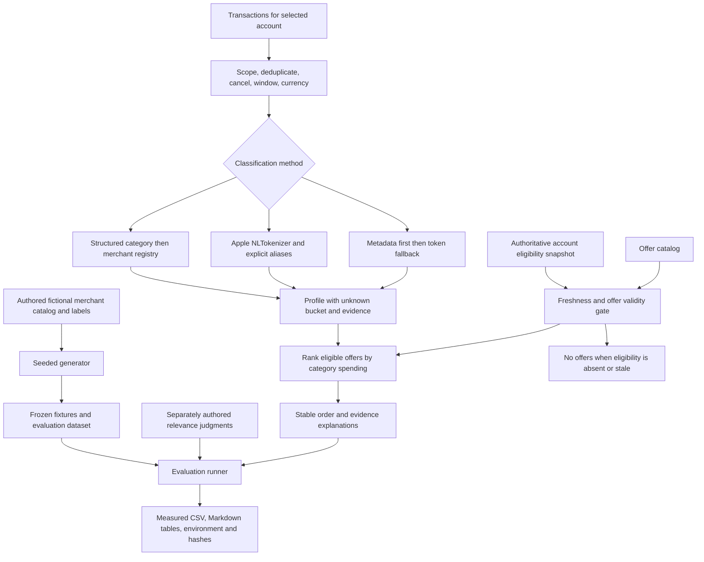

# Architecture and decision contract

`OfferCore` has no dependency on `SyntheticData` or `Evaluation`. `SyntheticData` imports only domain types from `OfferCore`; it never invokes classification. `Evaluation` implements count-based metrics; the executable joins these components. No network, third-party packages, trained model, financial account connection, persistence cache, or UI is involved.

Classification precedence is recognized non-unknown structured category, recognized merchant identifier, then token fallback (combined only). Conflicting structured metadata wins by declared policy, even when wrong. Token rules require exactly one matching category; multiple categories and no matches abstain. The tokenizer is instantiated per call, fixed to English, with POSIX case/diacritic normalization. Classification is expected to be repeatable on the recorded OS/framework version; cross-version tokenization equivalence is not promised.

A profile is immutable and tags account, currency, clock, and window. Account-local transaction IDs define identity. Exact duplicates count once; conflicting versions of an ID are all excluded. Purchases linked by a non-pending cancellation record dated no later than the supplied clock are excluded, even if the cancellation is outside the window. All scoped source records contribute cancellation links, including conflicting duplicates. Pending credits do not cancel settled spending. Positive posted debits within the inclusive `[now-window, now]` interval count; credits, pending, refunded, reversed, future and other-currency records do not. Partial refunds conservatively exclude the whole linked purchase. An unlinked refund cannot identify an original purchase; upstream linkage/completeness is a stated assumption. Amounts are integer minor units with checked cumulative overflow. Unknown spending is retained for audit but never increases any score.

The caller supplies an authoritative eligibility snapshot. This prototype models that trust boundary; it does not authenticate a bank service. It accepts only explicit `eligible`, the active account, `issuedAt <= now < expiresAt`, and age strictly less than 3,600 seconds by default. Missing, unknown, denied, future, stale, or cross-account decisions never become eligibility through spending. Recompute at each request; account or clock mismatch with the profile returns no offers. Offers must satisfy `validFrom <= now < validUntil` and matching currency. Conflicting offer IDs are excluded; identical duplicate offers count once.

Ranking score is the sum of category spending in cents, not a probability, confidence, monetary benefit, or estimate of intent. Ties use ascending offer ID. The eligible-only baseline uses zero scores and this same ID ordering. No recognized spend produces eligible-only ordering with a neutral explanation. Explanations report count, amount, window, evidence source and eligibility check time; underlying profile contributions expose the transaction IDs and matched evidence. Explanations are deterministic templates, with no claim of demonstrated human comprehension.
